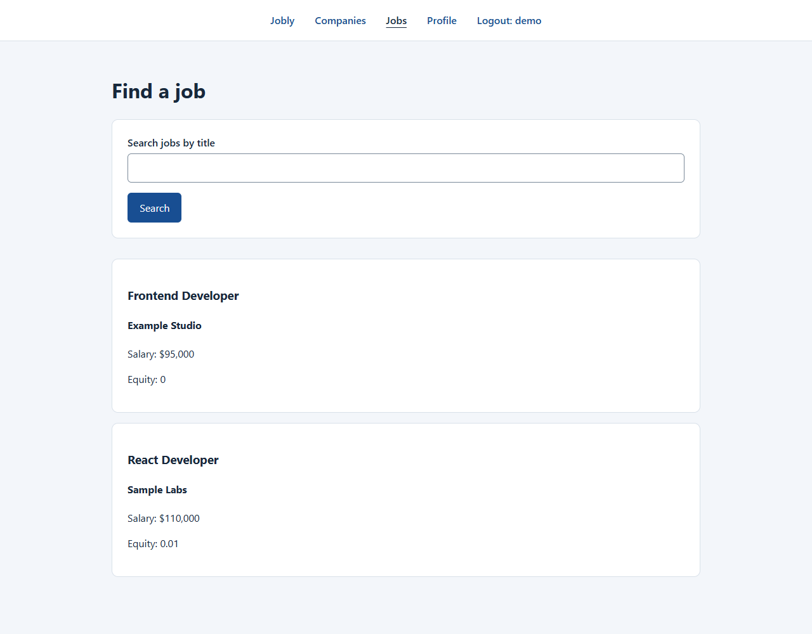

# Jobly — React Job Search App

A React portfolio project for exploring companies, searching job listings, and managing a user profile. Jobly connects a client-side interface to a separate REST API, with JWT authentication and shared session state.

**[Frontend repository](https://github.com/Peter-Loft/react-jobly)** · **[Companion backend](https://github.com/Peter-Loft/react-jobly-backend)**



*Local interface preview using mocked sample companies and jobs; these are not live vacancies.*

## Features

- **Account access:** sign up, log in, restore a saved session, and log out.
- **Company discovery:** browse companies, search by name, and open a company's available jobs.
- **Job search:** search by title and view salary and equity information.
- **Profile management:** update first name, last name, and email, with save confirmation and error feedback.
- **Resilient UI:** loading and empty states, recoverable request errors, and protection against stale search responses.
- **Responsive forms and navigation:** labeled inputs, keyboard focus indicators, and layouts that fit smaller screens.

This repository contains the frontend. Authenticated features require the companion backend and a PostgreSQL database. The frontend does not currently submit job applications.

## Engineering highlights

- **React hooks and Context** keep the authenticated user available across navigation and profile updates.
- **React Router** separates public pages from pages that require a session. The backend remains responsible for authorization.
- **A centralized API client** handles bearer tokens, request timeouts, encoded search parameters, and normalized errors without logging credentials.
- **Async state handling** prevents old search responses from replacing newer results and clears invalid stored sessions.
- **Behavior-focused regression tests** cover session recovery, login, profile saves, API failures, and search races.

## Stack

| Area | Technology |
| --- | --- |
| Interface | React 17, JavaScript, CSS |
| Navigation | React Router 5 |
| API access | Axios, JWT decoding |
| Development and build | Vite |
| Tests | Vitest, React Testing Library, jsdom |
| Companion API | Node.js, Express, PostgreSQL |

The project originally used Create React App. Its build and test tooling now use Vite and Vitest; React and React Router retain their existing major versions.

## Run locally

### 1. Start a compatible backend

Use the [companion backend repository](https://github.com/Peter-Loft/react-jobly-backend). It exposes the API on port **3001** by default and uses a PostgreSQL database named `jobly`, or the connection supplied through `DATABASE_URL`.

After cloning that repository and installing its dependencies, initialize a **new, empty local database** from the backend directory:

```sh
createdb jobly
psql -d jobly -f jobly-schema.sql
psql -d jobly -f jobly-seed.sql
npm start
```

Review the backend's own configuration before deployment. Its `jobly.sql` reset script drops and recreates databases; the commands above avoid using that reset script. The backend is maintained separately and is not included in this frontend's tests or dependency audit.

### 2. Install the frontend

Use **Node.js 24 or newer** and npm. A `.nvmrc` file pins the development major version to 24.

```sh
git clone https://github.com/Peter-Loft/react-jobly.git
cd react-jobly
npm ci
```

Copy `.env.example` to `.env` and adjust the API address if needed:

```dotenv
VITE_API_BASE_URL=http://localhost:3001
```

The default is already `http://localhost:3001`. Restart the development server after changing environment variables. Vite variables are embedded in browser code, so do not put secrets in this file.

```sh
npm start
```

Open **http://127.0.0.1:3000**, create an account, and browse companies or jobs. The backend must allow the frontend origin through CORS.

### 3. Check and build

| Command | Purpose |
| --- | --- |
| `npm start` / `npm run dev` | Start the local development server |
| `npm test` | Run the regression suite once |
| `npm run test:watch` | Rerun tests while developing |
| `npm run build` | Generate production files in `dist/` |
| `npm run preview` | Preview a production build locally |
| `npm audit` | Check installed dependencies against current advisories |

GitHub Actions runs installation, tests, and the production build for pushes and pull requests. Tests use mocked API responses and do not require PostgreSQL.

## API contract

| Operation | Endpoint |
| --- | --- |
| Log in | `POST /auth/token` |
| Sign up | `POST /auth/register` |
| Restore user | `GET /users/:username` |
| Save profile | `PATCH /users/:username` |
| Browse/search companies | `GET /companies?name=...` |
| Company details and jobs | `GET /companies/:handle` |
| Browse/search jobs | `GET /jobs?title=...` |

Protected requests send `Authorization: Bearer <token>`. Profile updates send only `firstName`, `lastName`, and `email`.

## Project structure

```text
src/
  App.jsx                 Session lifecycle and shared user state
  Routes.jsx              Public and authenticated routes
  api.js                  REST API client
  useSearchResults.js     Search loading, errors, and stale-response protection
  Company*.jsx            Company browsing and details
  Job*.jsx                Job search and cards
  *Form.jsx               Login, signup, profile, and search forms
  *.test.*                Regression tests
vite.config.js            Development and test configuration
.env.example              API address configuration
```

## Deployment and current limits

- Build with the deployed API's HTTPS address in `VITE_API_BASE_URL`, then host `dist/` on a static host.
- Configure the host to rewrite frontend routes such as `/companies/example` to `index.html`.
- The old CRA variable `REACT_APP_BASE_URL` is now `VITE_API_BASE_URL`; the output directory changed from `build/` to `dist/`.
- A live hosted demo is not configured in this repository.
- Tokens are stored in local storage for session persistence. A production deployment should review session storage and expiry with the backend; this app has no refresh-token flow.
- Job applications, pagination, and a React major-version upgrade are future improvements.
- Local frontend tests validate behavior with mocks. They do not establish end-to-end compatibility with a running backend and database.

## LinkedIn project description

> Jobly is a React job-search portfolio application with company discovery, searchable job listings, JWT-based account access, and editable user profiles. The frontend integrates with an Express/PostgreSQL API and demonstrates React hooks, Context, client-side routing, and asynchronous error handling. Recent maintenance adds regression tests and modernizes the build workflow with Vite and Vitest.

**Suggested skills:** React · JavaScript · REST APIs · Authentication · React Testing Library · Responsive Web Design

**Project link:** https://github.com/Peter-Loft/react-jobly

## Contributors

[Peter Loft](https://github.com/Peter-Loft) and Ryan Nissen contributed to the original project. See the repository's commit history for contributions.
